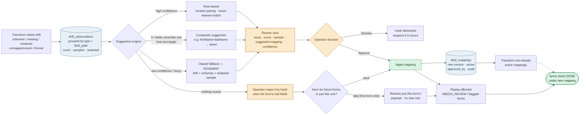

# Request processing flow

> **For non-engineers.** This shows the journey of one registration form through the system.
> The short version: every form is saved the instant it arrives, so nothing is ever lost; if the
> same form is sent twice it's only processed once; and if a step fails it retries on its own.
> A person is asked to help **only** when there's a genuine ambiguity the system can't safely
> decide — and that happens in the Drift Console, with no code changes or deploys needed.

How a single `POST /ingest` request travels through the system — from the untrustworthy
provider all the way to `FORM-BOT` and the confirmation email — including every failure and
dedupe branch.

```mermaid
flowchart TD
    A([Provider: POST /ingest]) --> B{Body JSON<br/>parseable?}
    B -- no --> B1[Store raw payload<br/>status = NEEDS_REVIEW]
    B1 --> R202
    B -- yes --> C[Loose-validate with Zod safeParse<br/>map known fields · keep unknowns]
    C --> C2[Compute payload_hash<br/>normalised hash of raw payload]
    C2 --> D[INSERT ingested_forms: session_id · payload_hash · raw JSONB<br/>ON CONFLICT session_id DO UPDATE<br/>duplicate_count++ · last_seen_at = now<br/>RETURNING inserted? + stored payload_hash]
    D --> E{Row actually<br/>inserted?}
    E -- yes --> F[status = PENDING]
    E -- "no — session_id<br/>already seen" --> E0{payload_hash ==<br/>stored hash?}
    E0 -- "yes — true duplicate" --> E1[Record duplicate · metric 'ingest.duplicate'<br/>do NOT reprocess]
    E0 -- "no — same id,<br/>different content" --> E2[INSERT form_conflicts: new payload<br/>never overwrites the original row]
    E2 --> E3{original status<br/>already terminal?<br/>DONE/FAILED/NEEDS_REVIEW}
    E3 -- "no — still in flight" --> E4[status = NEEDS_REVIEW<br/>metric 'ingest.conflict']
    E3 -- "yes — preserve it" --> E5[original untouched<br/>pendingConflicts++ for operator]
    E1 --> R202
    E4 --> R202
    E5 --> R202
    F --> R202([Respond 202 Accepted])

    R202 -. we now own all retries; work continues async .-> G

    subgraph WORKER [Worker loop · crash-safe · multi-worker safe]
        direction TB
        G[Atomic claim: FOR UPDATE SKIP LOCKED<br/>status = PROCESSING · claimed_at = now] --> H[Transform<br/>parse-full-name · gender remap<br/>DOB date-only · flatten address]
        H --> H2{Transform<br/>outcome?}
        H2 -- "degraded but usable<br/>(coerced gender, lossy name,<br/>missing session_id)" --> HF[set soft flag<br/>keep processing] --> I
        H2 -- "can't resolve<br/>required field" --> X
        H2 -- ok --> I[status = TRANSFORMED<br/>upsert transformed_forms]
        I --> J[Call geocoder · timeout-guarded<br/>postcode → lat / lng]
        J --> K{2xx?}
        K -- "no — transient / timeout" --> K1{attempts &lt; max?}
        K1 -- yes --> K2[backoff + jitter<br/>attempts++] --> J
        K1 -- "no — exhausted" --> X
        K -- yes --> L[status = GEOCODED<br/>save longitude / latitude]
        L --> M[Enqueue outbox rows: FORMBOT + EMAIL<br/>ON CONFLICT form_id,type DO NOTHING]
        M --> N[status = DISPATCHED]
    end

    H -. "unexpected throw (our bug)<br/>→ permanent" .-> FAIL
    J -. "unexpected throw<br/>→ permanent" .-> FAIL

    subgraph DISPATCH [Outbox dispatcher · independent per-row retries]
        direction TB
        N --> O[Claim FORMBOT row → SENDING<br/>send with idempotency_key]
        O --> O2{Deterministic ack?}
        O2 -- "accepted / already-have-it" --> P[mark DELIVERED<br/>exactly-once effect ✓]
        O2 -- "no ack / crash" --> O3[stays SENDING] -.->|reconciliation sweep re-drives| O
        N --> Q[Claim EMAIL row → SENDING<br/>independent of FORM-BOT]
        Q --> Q2{2xx?}
        Q2 -- no --> Q3[backoff retry<br/>high cap · 'guaranteed'] --> Q
        Q2 -- yes --> QD[email DELIVERED]
        P --> S{both rows<br/>DELIVERED?}
        QD --> S
        S -- yes --> DONE([status = DONE])
    end

    X[status = NEEDS_REVIEW] -.-> HUMAN([Human review queue<br/>data decision · then replay])
    FAIL[status = FAILED] -.-> DEV([Dev queue<br/>fix code · then replay])

    classDef store fill:#e8f0f7,stroke:#336791,color:#1f3b52;
    classDef ok fill:#dcf3e4,stroke:#15803d,color:#0f3d22;
    classDef warn fill:#fbeacb,stroke:#b45309,color:#5a3608;
    classDef crit fill:#fbdde4,stroke:#be123c,color:#5c0f22;
    classDef resp fill:#d8efec,stroke:#0f766e,color:#0b4f49;
    class D,I,L,M,E2 store;
    class P,QD,DONE ok;
    class B1,X,E4,E5,HF,HUMAN warn;
    class FAIL,DEV crit;
    class R202 resp;
```

## Reading the diagram

- **Durable front door.** The request is persisted and acknowledged (`202`) *before* any risky
  work. The provider gets a fast ack; everything flaky happens behind it.
- **What counts as "the same"?** The idempotency key is `session_id` — the per-submission UUID the
  provider replays when it redelivers. Two different registrations have different `session_id`s and
  stay distinct; a redelivery of one submission reuses it and collapses. *(Assumption: the provider
  reuses `session_id` on resend rather than minting a fresh one. The brief says it's badly behaved,
  so `payload_hash` below is the safety net that still catches byte-identical replays if that
  assumption ever breaks.)*
- **Dedupe is atomic — and observed.** `ON CONFLICT (session_id) DO UPDATE` never inserts a second
  row (no check-then-write race) *and* bumps `duplicate_count` + `last_seen_at` in the same
  statement. A metric/log (`ingest.duplicate`) makes redelivery rate visible instead of discarded.
  Response is still `202`, identical to the first time — that's what makes it idempotent.
- **Same id, *different* content is not a duplicate — and the new data is never thrown away.**
  Comparing `payload_hash` against the stored hash splits the conflict three ways: **new**
  (processed), **true duplicate** (same id + same hash → counted, not reprocessed), and
  **conflict** (same id + different hash). A conflict always lands in `form_conflicts`, in full —
  if the original is still in flight it also escalates to `NEEDS_REVIEW`; if the original already
  reached a terminal state (`DONE`/`FAILED`/`NEEDS_REVIEW`) it is deliberately left untouched —
  we never reopen or silently reprocess a decided outcome — but the new payload still waits,
  visible as `pendingConflicts`, for an operator to apply (accept it as the correction) or dismiss.
- **The worker is resumable and multi-worker safe.** Claiming uses `FOR UPDATE SKIP LOCKED` and
  flips the row to `PROCESSING` with a `claimed_at` lease — two workers never grab the same form,
  and a worker that dies mid-flight has its row reclaimed after the lease expires. Every box that
  changes `status` is a committed checkpoint, so a crash resumes from the last status, never the start.
- **Exactly-once is built, not assumed.** There's no transactional exactly-once to an external
  system (dual-write problem). Instead: the outbox `UNIQUE(form_id, type)` guarantees **one work
  item**; an **idempotency key + deterministic ack** from FORM-BOT guarantees **one effect**; and we
  mark `DELIVERED` *only on ack*. A row left in `SENDING` (crash / lost ack) is re-driven by a
  **reconciliation sweep** — safe to resend because the key dedupes it.
- **Independent per-row delivery.** The FORMBOT and EMAIL outbox rows retry on their own schedules,
  so a stuck FORM-BOT never blocks the "guaranteed" email (which is gated on *transform* success,
  not delivery).
- **Two dead-letter queues, two owners.** `NEEDS_REVIEW` = a *data* problem (ambiguous / unresolved
  drift) → human decides, then replay. `FAILED` = *our* problem (a deterministic bug / unexpected
  throw) → fixed fast without burning retries, then replay. Transient blips retry; deterministic
  errors don't.
- **Soft flag vs hard quarantine.** Degraded-but-usable cases (coerced gender, lossy name split,
  missing `session_id`) get a `flags` note and keep flowing to `DONE`; only can't-proceed cases
  block in `NEEDS_REVIEW`. Keeps the review queue small and high-signal.

---

# Self-healing drift loop

Recurring schema drift shouldn't be a standing incident. Every mismatch is recorded, grouped,
and turned into a **suggested mapping** an on-call engineer approves — then an agent applies it
(a versioned DB mapping, hot-reloaded) and replays the stuck forms. No deploy, no 3am coding.

**Guardrails:** nothing auto-applies without an approved suggestion — a `composite` suggestion
*especially* never auto-applies, since join-vs-alternatives can't be settled from field names
alone (two built-in curated composites, `firstName`+`lastName` and the snake_case equivalent, are
the one exception — they auto-resolve with no review at all). Mappings are versioned + reversible
(roll back = deactivate the version + re-replay); drift observations stay PII-free (redacted
shapes/exemplars only) — the deliberate exception is the hand-mapping view, which an authorized
operator uses to see a *specific* stuck form's real fields; replay is idempotent; a dismissed
observation reopens if the same drift recurs, so it's never a silent dead end.

**Built:** `drift_observations`, a grouped `GET /drift`, rule-based suggestions including
composite (N→1) detection, the `field_mappings` table + hot-reload, manual replay, the hand-mapping
escape hatch (view payload → apply save-or-skip), and a working console wired to all of it.
**Roadmap:** the LLM (Claude) fallback for suggestions the rule engine scores low — the one
genuinely unbuilt piece.
